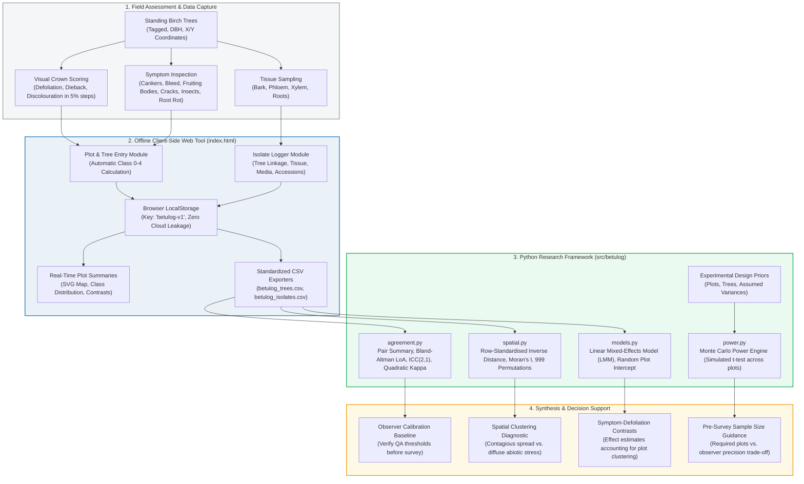

# Betulog: Linked Crown-Health, Symptom, and Isolate Records for Birch Surveys, with Observer Calibration, Spatial Diagnostics, and Design-Power Analysis

**Arpan Ghosh**  
*Independent Researcher (Applied AI Systems & Biometrics), Birbhum, West Bengal, India*  
**Contact:** `arpanghosh984@gmail.com` | [GitHub Profile](https://github.com/Arpanthebaap)  
Version 0.2.0 · MIT licence  
[](https://doi.org/10.5281/zenodo.23369867)
[](https://github.com/Arpanthebaap/betulog/actions/workflows/tests.yml)
[](https://github.com/Arpanthebaap/betulog/actions/workflows/pages.yml)
[](https://www.python.org/)
[](https://opensource.org/licenses/MIT)  
**Live Web Application:** https://arpanthebaap.github.io/betulog/ · **Source Code:** https://github.com/Arpanthebaap/betulog

---

> **Status: Research Software Framework (v0.2.0).** The software is complete and verified (8 core Python unit tests and cross-language Node.js parity test). Section 6.2 reports a **computer simulation under explicit stated assumptions**, not field data. **No field results exist yet and none are claimed.** Example datasets in `data/` are synthetic and labelled as such. Field validation on operational forest plots is pending.

---

## Abstract

Silver birch (*Betula pendula*) and downy birch (*Betula pubescens*) are of growing silvicultural and ecological importance across northern and central Europe. However, young plantations frequently suffer from browsing, defoliators, and shoot blights, while older stands display a multifactorial crown decline syndrome whose etiology remains incompletely resolved. Untangling interacting abiotic stressors and biotic fungal or oomycete pathogens requires consistent crown condition scoring, standardized symptom recording, and an unbroken chain of custody linking individual symptomatic trees to cultured isolates and DNA accessions. 

Visual crown assessments are inherently subjective, introducing inter-observer variance that confounds spatial and temporal comparisons. Furthermore, forest pathology surveys rarely justify their sampling designs (number of plots vs. trees per plot) with statistical power calculations. **Betulog** addresses these systemic gaps through an open-source, dual-layer architecture:
1. **An offline-first, client-side web application (`index.html`)** that records tree coordinates, DBH, defoliation percentages, ICP Forests crown classes (0–4), eight specific symptom flags, and directly linked fungal isolate records without requiring servers, user accounts, or internet connectivity.
2. **A Python research framework (`betulog`)** providing rigorous quality-assurance tools: paired-observer agreement statistics (Bland-Altman limits of agreement, $\text{ICC}(2,1)$, quadratic-weighted kappa), spatial autocorrelation diagnostics (Moran's $I$ with Monte Carlo permutation), linear mixed-effects symptom models, and a Monte Carlo power simulation engine for study design.

In a design-power simulation, the probability of detecting a 5-point symptom-associated defoliation difference rose from 0.22 with 6 plots to 0.96 with 40 plots, while observer measurement error of 15 percentage points reduced power from 0.61 to 0.38 at 15 plots. These findings underscore the quantitative value of pre-survey observer calibration.

---

## System Architecture



---

## 1. Scientific Background & Related Work

Birch crown dieback has been documented across various European regions with differing primary agents:
- In Scotland, widespread dieback of young planted birch (*Betula pendula* and *B. pubescens*) emerged in native woodland schemes, with *Marssonina betulae* (causing shoot lesions and leaf anthracnose) and *Anisogramma virgultorum* (birch canker) identified as major biotic drivers interacting with site exposure (Green, 2005).
- In Finland, investigations on mature birches demonstrated complex successional dynamics of fungal communities on twigs in thinning crowns (Paavolainen et al., 2001).
- In western Ukraine, multiple *Phytophthora* species (*P. cactorum*, *P. plurivora*) were isolated from rhizosphere soil and bark lesions in declining broadleaved forests containing silver birch (Matsiakh et al., 2021).

These studies illustrate that birch decline typically involves interacting biotic and abiotic agents that vary between geographic locations. Evaluating these dynamics requires rigorous field protocols and clear data linkage.

---

## 2. Theoretical Formulations & Methodology

### 2.1 Crown Scoring & ICP Forests Classifications
Visual defoliation represents needle or leaf loss relative to a fully foliated local reference tree in 5% increments. In accordance with the **ICP Forests Manual (Part IV: Visual Assessment of Crown Condition and Damaging Agents; ICP Forests Expert Panel, 2020)**, defoliation percentages map into five standard crown classes:

$$\text{Class}(d) = \begin{cases} 
0 \quad (\text{None}), & 0 \le d \le 10 \\ 
1 \quad (\text{Slight}), & 10 < d \le 25 \\ 
2 \quad (\text{Moderate}), & 25 < d \le 60 \\ 
3 \quad (\text{Severe}), & 60 < d < 100 \\ 
4 \quad (\text{Dead}), & d \ge 100 \text{ or Tree Dead = True} 
\end{cases}$$

### 2.2 Observer Agreement Statistics
To calibrate two observers ($a$ and $b$) scoring the same $n$ trees independently:
- **Mean Bias:** $\bar{d} = \frac{1}{n} \sum_{i=1}^n (a_i - b_i)$
- **95% Limits of Agreement (Bland & Altman):** $\bar{d} \pm 1.96 \cdot s_d$, where $s_d = \sqrt{\frac{1}{n-1} \sum (d_i - \bar{d})^2}$
- **Mean Absolute Difference (MAD):** $\text{MAD} = \frac{1}{n} \sum_{i=1}^n |a_i - b_i|$
- **Intraclass Correlation Coefficient $\text{ICC}(2,1)$:** Two-way random-effects model assessing absolute agreement:
  $$\text{ICC}(2,1) = \frac{\text{MSR} - \text{MSE}}{\text{MSR} + (k-1)\text{MSE} + \frac{k}{n}(\text{MSC} - \text{MSE})}$$
  where $\text{MSR}$ is mean square for rows (trees), $\text{MSC}$ is mean square for columns (observers), and $\text{MSE}$ is residual error variance ($k=2$).
- **Quadratic-Weighted Cohen's Kappa ($\kappa_w$):** For categorical crown classes ($0$ to $4$):
  $$\kappa_w = 1 - \frac{\sum_{i=0}^4 \sum_{j=0}^4 w_{ij} O_{ij}}{\sum_{i=0}^4 \sum_{j=0}^4 w_{ij} E_{ij}}, \quad w_{ij} = \frac{(i - j)^2}{(5 - 1)^2}$$

### 2.3 Spatial Autocorrelation (Moran's $I$)
To test whether crown defoliation is spatially clustered within a plot, we construct an inverse-distance spatial weight matrix $W$ with elements $w_{ij} = 1 / d_{ij}$ ($w_{ii} = 0$), row-standardised such that $\sum_j w_{ij} = 1$:

$$I = \frac{n}{\sum_{i=1}^n \sum_{j=1}^n w_{ij}} \cdot \frac{\sum_{i=1}^n \sum_{j=1}^n w_{ij} (z_i - \bar{z})(z_j - \bar{z})}{\sum_{i=1}^n (z_i - \bar{z})^2}$$

Statistical significance ($p$-value) is established non-parametrically through 999 random permutations of defoliation values across tree coordinates. A significantly positive $I$ ($p < 0.05$) suggests contagious spread from local foci, whereas $I \approx 0$ indicates diffuse or stand-level environmental stressors.

### 2.4 Linear Mixed-Effects Association Model
To test associations between specific symptoms (e.g. cankers, bleeding lesions, root rot) and defoliation while accounting for spatial clustering at the plot level:

$$y_{ij} = \beta_0 + \sum_{k} \beta_k X_{ijk} + u_j + \varepsilon_{ij}$$

where $y_{ij}$ is defoliation (%) of tree $i$ in plot $j$, $X_{ijk}$ are binary indicator flags for symptom $k$, $u_j \sim \mathcal{N}(0, \sigma_{\text{plot}}^2)$ is a random intercept for plot $j$, and $\varepsilon_{ij} \sim \mathcal{N}(0, \sigma_\varepsilon^2)$ is residual error.

---

## 3. Operations & User Manual

### 3.1 Operating the Client-Side Web Application (`index.html`)

The web tool is fully self-contained in a single file with zero runtime dependencies. It runs directly in any modern desktop or mobile browser.

#### Tab 1: Plot and Trees
1. **Define Plot Metadata:** Enter Plot ID (e.g., `ALN-01`), Site name, Stand type (`Young plantation` or `Older stand`), Stand age (years), Date, and Observer initials.
2. **Log Tree Parameters:**
   - **Coordinates:** Measure and input tree $X$ and $Y$ offsets (in metres) from the plot baseline/corner.
   - **Stem Size:** Measure stem diameter at breast height (DBH, cm).
   - **Crown Assessment:** Record defoliation %, crown dieback %, and discolouration %.
   - **Symptom Flags:** Check observed indicators (stem canker, sap bleeding, fruiting bodies, bark cracks, insect damage, browsing, root rot, dead).
   - **GPS Capture:** Click **"Save GPS to notes"** to append device GPS coordinates.
3. Click **"Add tree"**. The tree is instantly assigned its ICP Forests class and appended to the local table.

#### Tab 2: Isolates
1. Ensure trees are registered in Tab 1.
2. Select the target **Tree ID** from the dropdown menu.
3. Assign a unique **Isolate ID** (e.g., `ISO-ALN01-001`).
4. Select the sampled tissue (`Bark lesion margin`, `Inner bark`, `Xylem`, `Root`, `Fruiting body`, `Leaf`, `Twig`, `Soil`).
5. Record isolation date, culture medium (e.g., `MEA`, `PDA`), morphotype notes, and public DNA accessions (e.g., GenBank accession).
6. Track status through the workflow: `Plated` $\rightarrow$ `Pure culture` $\rightarrow$ `DNA extracted` $\rightarrow$ `Sequenced` $\rightarrow$ `Identified` $\rightarrow$ `Contaminated`.

#### Tab 3: Summary & Visualization
1. Select the active plot to inspect real-time diagnostics:
   - **Class Distribution Bar:** Visual breakdown of trees across classes 0 to 4.
   - **Dynamic SVG Tree Map:** Plots tree locations with circle diameter scaled by DBH and fill color corresponding to ICP Forests crown class.
   - **Symptom Contrasts:** Displays mean defoliation for trees exhibiting each symptom versus trees without the symptom.
   - **Sampling Prompts:** Rule-based suggestions triggered when specific symptoms exceed 10% prevalence.
2. **Export Data:** Click **"Export trees CSV"** and **"Export isolates CSV"** at the conclusion of each field session.

---

### 3.2 Operating the Python Research Framework

#### Installation
```bash
# Clone the repository
git clone https://github.com/Arpanthebaap/betulog.git
cd betulog

# Set up virtual environment
python -m venv .venv
source .venv/bin/activate   # On Windows: .venv\Scripts\Activate.ps1

# Install in editable mode with development dependencies
pip install -e ".[dev]"
```

#### Running the Test Suites
```bash
# Run the 8 core Python unit tests
pytest -v

# Run the cross-language Node.js parity test
node tests/parity.test.mjs
```

#### Diagnostic Survey Analysis
Run the baseline analysis pipeline on exported CSV files:
```bash
python analysis/analyse.py data/example_trees.csv data/example_isolates.csv
```

#### Observer Calibration Analysis
Compute paired-observer agreement metrics on a 2-observer calibration dataset:
```bash
python analysis/observer_agreement.py data/pilot_observers_synthetic.csv
```

---

## 4. Observer Calibration & Pilot Protocol

Before executing full-scale surveys across multiple stands, teams must complete a formal observer calibration exercise to ensure that scoring differences reflect forest health rather than observer bias.

### 4.1 Calibration Protocol Summary
1. **Tree Selection:** Mark 30 birch trees exhibiting a wide gradient of crown health (healthy to severely defoliated).
2. **Independent Scoring:** Observer 1 and Observer 2 independently record defoliation in 5% increments without communication.
3. **Save Paired CSV:** Save records in `tree,observer1,observer2` format.
4. **Evaluate QA Thresholds:** Run `python analysis/observer_agreement.py <path>`.

### 4.2 Quality Assurance Acceptance Thresholds
Prior to operational survey deployment, paired scoring must satisfy:
- **Mean Bias:** Within $\pm 5.0$ percentage points.
- **Mean Absolute Difference (MAD):** $\le 10.0$ percentage points.
- **Tolerance Share:** $\ge 85\%$ of observations within 10 percentage points.
- **Intraclass Correlation $\text{ICC}(2,1)$:** $\ge 0.85$.
- **Quadratic Weighted Kappa ($\kappa_w$):** $\ge 0.75$ on ICP Forests crown classes.

For complete field steps and plot design guidelines, see [docs/FIELD_PROTOCOL.md](docs/FIELD_PROTOCOL.md) and [docs/PILOT_PLAN.md](docs/PILOT_PLAN.md).

---

## 5. Software Verification Results

### 5.1 Automated Test Suites
All 8 core Python unit tests and the cross-language Node.js parity test pass:
- **Class Boundary Conformance:** Verified against ICP Forests manual thresholds.
- **Agreement Metric Identities:** $\kappa_w = 1.0$ and $\text{ICC}(2,1) = 1.0$ for identical scores; verified penalty under systematic rater bias.
- **Spatial Clustering Sensitivity:** Moran's $I$ detects positive spatial autocorrelation ($p < 0.05$) in clustered synthetic coordinates while remaining non-significant ($p > 0.01$) in uniform spatial noise.
- **Model Estimation:** Linear mixed-effects regression accurately recovers planted symptom coefficients.
- **Cross-Language Parity:** Complete agreement between JavaScript `cls()` in `index.html` and Python `defol_class` across boundary inputs `[0, 10, 11, 25, 26, 60, 61, 99, 100]` and dead tree states.

### 5.2 Paired Observer Calibration Verification
Evaluating `analysis/observer_agreement.py` against the synthetic 30-tree calibration benchmark ([data/pilot_observers_synthetic.csv](data/pilot_observers_synthetic.csv)):

| Metric | Output Value | Calibration Status |
|---|---|---|
| **Evaluated Trees** | 30 | Standard calibration sample |
| **Mean Bias (Obs 1 - Obs 2)** | -1.33 percentage points | Passed (Threshold: $\pm 5.0$) |
| **95% Limits of Agreement** | [-8.11, +5.44] | Symmetrical, low dispersion |
| **Mean Absolute Difference (MAD)** | 2.67 percentage points | Passed (Threshold: $\le 10.0$) |
| **Share within 5% Tolerance** | 100.0% | Excellent precision |
| **Share within 10% Tolerance** | 100.0% | Passed (Threshold: $\ge 85\%$) |
| **Intraclass Correlation $\text{ICC}(2,1)$** | 0.988 | Passed (Threshold: $\ge 0.85$) |
| **Quadratic Weighted Kappa ($\kappa_w$)** | 0.967 | Passed (Threshold: $\ge 0.75$) |

---

## 6. Design-Power Simulation Results

### 6.1 Simulation Design & Parametric Assumptions
Power to detect a true symptom-associated difference in defoliation is evaluated using a Monte Carlo simulation (`src/betulog/power.py`):
- **Design:** Hierarchical balanced design with 20 trees per plot.
- **Plot-Level Random Effect:** $u_j \sim \mathcal{N}(0, \sigma_{\text{plot}}^2)$ with $\sigma_{\text{plot}} = 8$ percentage points.
- **Symptom Prevalence:** Bernoulli probability $p = 0.30$ per tree.
- **Tree-Level Residual Noise:** $\varepsilon_{ij} \sim \mathcal{N}(0, \sigma_{\text{tree}}^2)$ with $\sigma_{\text{tree}} = 15$ percentage points.
- **Observer Error:** Gaussian noise added to perceived defoliation with standard deviation $\sigma_{\text{obs}}$, rounded to 5% increments and clipped to $[0, 100]$.
- **Test Statistic:** Within-plot difference in mean defoliation ($\bar{y}_{\text{symptomatic}} - \bar{y}_{\text{asymptomatic}}$) evaluated across plots via a one-sample $t$-test at $\alpha = 0.05$ (400 simulations per parameter cell, seed = 5).

### 6.2 Simulated Power Curves

| Scenario | Plots ($N$) | True Effect ($\Delta$) | Observer Error ($\sigma_{\text{obs}}$) | Statistical Power ($1 - \beta$) |
|:---:|:---:|:---:|:---:|:---:|
| **A** | 6 | 5.0 points | 6.0 points | **0.22** |
| **A** | 10 | 5.0 points | 6.0 points | **0.37** |
| **A** | 15 | 5.0 points | 6.0 points | **0.55** |
| **A** | 20 | 5.0 points | 6.0 points | **0.69** |
| **A** | 30 | 5.0 points | 6.0 points | **0.86** |
| **A** | 40 | 5.0 points | 6.0 points | **0.96** |
| **B** | 15 | 5.0 points | 0.0 points (Perfect) | **0.61** |
| **B** | 15 | 5.0 points | 10.0 points | **0.49** |
| **B** | 15 | 5.0 points | 15.0 points | **0.38** |
| **C** | 15 | 2.5 points | 6.0 points | **0.18** |
| **C** | 15 | 7.5 points | 6.0 points | **0.86** |
| **C** | 15 | 10.0 points | 6.0 points | **1.00** |

*Full simulation dataset available at [`results/power_simulation.csv`](results/power_simulation.csv).*

### 6.3 Scientific Implications
1. **Plot Count Dominance:** For a moderate symptom effect of 5 percentage points, sampling 6–10 plots yields inadequate power ($\le 0.37$). Reaching the standard target power of $0.80$ requires approximately 26–28 plots under these variance conditions.
2. **Quantitative Return on Observer Calibration:** At a fixed design of 15 plots, reducing observer error from $\sigma_{\text{obs}} = 15$ to $\sigma_{\text{obs}} = 0$ via pre-survey training increases power from $0.38$ to $0.61$—an effective gain equivalent to adding approximately 8 additional forest plots.
3. **Variance Sensitivity:** **All simulation figures depend directly upon the assumed variance components.** Researchers should replace these default priors with empirical estimates derived from local pilot data.

---

## 7. Limitations & Scientific Boundaries

1. **Subjective Visual Estimation:** Defoliation assessments remain visual estimates influenced by crown illumination, viewing angle, and seasonal leaf flush. Phenological dates must be recorded systematically.
2. **Correlation vs. Causation:** Observed symptom flags and crown defoliation co-occur in nature. Statistical associations do not establish etiology; fungal and oomycete pathogenicity requires Koch's postulates and controlled seedling inoculations.
3. **Spatial Weighting Bounds:** Moran's $I$ calculated with inverse-distance weighting is sensitive to edge effects, plot dimensions, and stem density.
4. **Client-Side Storage:** Browser `localStorage` is device-specific and does not provide multi-user synchronization or automated backups. Data must be exported to CSV at the end of each field day.
5. **Sampling Prompts:** Prompts provided in the application reflect general forest pathology field practice and have not been reviewed by a regional specialist. Investigators must verify protocols against local diagnostic guides.

---

## 8. Reproducibility & Open Science

- **Version Control & Repository:** All source code, analysis scripts, and documentation are publicly maintained at [https://github.com/Arpanthebaap/betulog](https://github.com/Arpanthebaap/betulog).
- **Public Documentation:**
  - [docs/DATA_DICTIONARY.md](docs/DATA_DICTIONARY.md): Comprehensive schema and column descriptions.
  - [docs/FIELD_PROTOCOL.md](docs/FIELD_PROTOCOL.md): Field sampling and laboratory chain-of-custody protocols.
  - [docs/PILOT_PLAN.md](docs/PILOT_PLAN.md): 30-tree observer calibration plan.
  - [docs/DATASETS.md](docs/DATASETS.md): Guidelines on pilot data collection and national inventory access.
  - [docs/COLLABORATION_ONE_PAGER.md](docs/COLLABORATION_ONE_PAGER.md): Scientific collaboration overview.

---

## 9. Ethics, Data & AI-Use Statement

- **Ethics & Land Access:** Field researchers must obtain written landowner and institutional permission prior to surveying or destructive sampling. Exact geographic coordinates of private forest lands should be kept confidential.
- **AI-Use Disclosure:** *The software codebase and documentation were drafted with AI assistance (Claude, Anthropic; Gemini, Google DeepMind) and rigorously reviewed, audited, verified, executed, and edited by the author, who assumes full scientific and technical responsibility for the content.*

---

## References

- Green, S. (2005). *Birch dieback in Scotland.* Forestry Commission Information Note FCIN072, Forest Research.
- ICP Forests Expert Panel on Crown Condition and Damage Causes (2020). Visual assessment of crown condition and damaging agents. Part IV of the *Manual on methods and criteria for harmonized sampling, assessment, monitoring and analysis of the effects of air pollution on forests*. UNECE ICP Forests Programme Co-ordinating Centre. https://www.icp-forests.net/manual
- Matsiakh, I., Kramarets, V., & Cleary, M. (2021). Occurrence and diversity of *Phytophthora* species in declining broadleaf forests in western Ukraine. *Forest Pathology*, 51(1), e12662. doi:10.1111/efp.12662
- Paavolainen, L., Hantula, J., Hallaksela, A.-M., & Kurkela, T. (2001). Dynamics of crown thinning and mycobiota on fallen twigs of mature birches (*Betula pendula*) in Finland. *Scandinavian Journal of Forest Research*, 16(3), 246–252. doi:10.1080/02827580119018

---

## Citation & License

This project is licensed under the **MIT License** — see [LICENSE](LICENSE) for terms. If you use Betulog in your research or field monitoring, please cite:

```bibtex
@software{ghosh2026betulog,
  author       = {Ghosh, Arpan},
  title        = {Betulog: Linked Crown-Health, Symptom, and Isolate Records for Birch Surveys, with Observer Calibration, Spatial Diagnostics, and Design-Power Analysis},
  year         = {2026},
  version      = {0.2.0},
  publisher    = {Zenodo},
  doi          = {10.5281/zenodo.23369867},
  url          = {https://doi.org/10.5281/zenodo.23369867}
}
```
*See [CITATION.cff](CITATION.cff) for machine-readable CFF format.*
